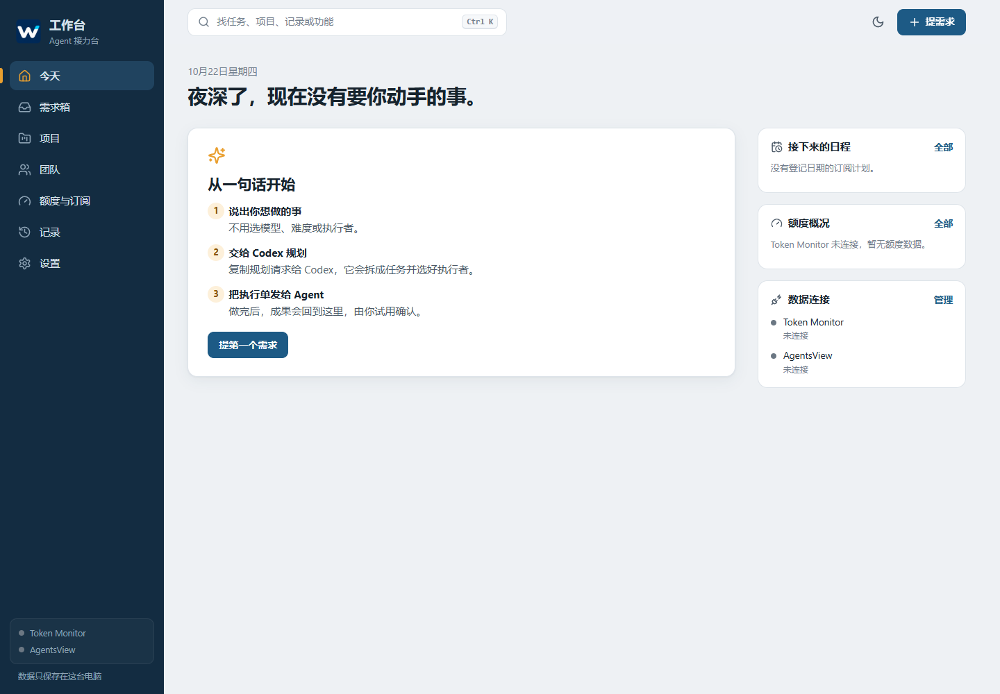

# Agent Workbench · 工作台

一个面向 Windows 的本地 Agent 项目管理桌面应用。把散落的项目、AI 团队、额度、需求、执行记录和成果放到一起，以中文界面管理每天的工作。

它保留你熟悉的协作方式：**提出需求 → Codex 规划 → 复制执行单给 Agent → 接收成果 → Review → 自己确认通过或退回**。

## 开始使用

从 [Releases](https://github.com/Houraiji9/agent-workbench/releases) 下载 Windows 便携包，完整解压到当前用户可写的文件夹，双击 `桌面版/工作台/工作台.exe`。便携包自带运行环境，不需要安装 Node。

- 最小化：收进右下角托盘，继续运行。
- 关闭窗口，或在托盘选择“退出工作台”：结束工作台及它本次启动的数据服务。
- 再次打开：恢复本地项目与记录。请保留整个文件夹，不要只移动 EXE。
- 可选运行 `scripts/安装开始菜单入口.ps1`，创建开始菜单入口后自行固定。

系统要求：Windows 10/11 x64；需要本机可用的 4317 端口。当前是便携版，程序未签名，首次启动可能出现 Windows 信誉提示；从本仓库下载并核对发布页校验值后再决定运行。

## 第一次使用

1. 在“项目”登记自己的文件夹，或建立项目；也可以归档暂时不用的项目。
2. 在“团队”添加需要的软件。预设库提供常见工具的资料和图标，添加后可以编辑职责和模型。
3. 在“额度”登记手动额度，或连接已有 Token Monitor。积分可填写月度基础、剩余及刷新日期。
4. 点击“提需求”。“先记下来”留作想法；“现在开始”交给 Codex 规划，页面提供可复制的衔接内容。
5. 把生成的执行单发到对应 Agent 会话。交付后查看成果、审查和验收；不满意时填写原因，一键复制返工指令。

首次启动只带 Codex、Claude、Grok Build 三个可编辑团队模板，以及当前工作台项目；没有账号、订阅、余额、会话或已完成任务。按自己的使用情况添加和删除即可。



## 主要功能

| 功能 | 当前支持 |
| --- | --- |
| 今日与项目 | 待处理事项、需求箱、项目路径、归档与上下文 |
| 团队与额度 | 42 项预设、自定义团队/模型、共享池、多窗口、月度积分、订阅与日程 |
| 执行单 | 稳定 Task/Run、真实文件包、签名回执、重试与返工 |
| 成果与验收 | 图片/文本/HTML 等预览、文件夹定位、hash 绑定 Review、通过与退回 |
| Codex MCP | 查询资源与历史、提交计划、导出执行单、按 Run 回报 |
| Token Monitor | 读取 Hub 额度和用量，离线保留最后快照 |
| AgentsView | 读取会话列表/搜索/详情，关联项目与执行记录 |
| Archify | 本地图解渲染、固定项目图解入口 |

外部集成默认未连接，需要在自己的电脑配置。工作台不购买订阅，不调用收费模型 API 自动派单，也不代替各 Agent 客户端。模型目录是带日期的资料快照，后续可编辑。

## 从源码启动

安装 Node.js **24+**、npm 和 Git，在项目目录运行：

```powershell
npm ci
npm run desktop:build
.\启动工作台.ps1
```

关闭用窗口关闭按钮，或 `停止工作台.ps1`。源码开发可用 `npm run dev` 启动本机后台、`npm run build` 构建页面。日常使用建议桌面入口；开发后台与桌面版不要同时占用相同端口。

```powershell
npm test
npm run test:e2e
```

页面测试默认使用 Chrome，测试数据放在独立临时目录。没有 Chrome 时先 `npx playwright install chromium`，再设置 `$env:PW_CHROMIUM='1'`。所有测试夹具均为模拟数据。

## 数据和备份

项目列表、任务、订阅和额度存于本地 `data/`；各项目的执行包存于 `.agent-workbench/`；本机设置位于 `config/local.json`。这些目录不进入公开仓库。移动已有项目后请核对登记路径；便携程序移动不等于迁移外部项目。

在设置中创建备份。备份包含账本、成果副本、执行包和本地凭据，应在私人位置保管。恢复仅写新目录，具体见 [使用与维护](docs/USAGE.md)。软件不提供云端同步或操作系统级隔离，其他能读取你文件夹的本机用户也可能读取这些数据。

## 文档

- [日常使用与排错](docs/USAGE.md)
- [Codex MCP 与规划手册](docs/CODEX_PLANNER.md)
- [外部数据连接](docs/INTEGRATIONS.md)
- [团队与额度管理](docs/团队与额度管理.md)
- [成果文件夹](docs/成果文件夹使用说明.md)
- [执行单与回执协议](docs/EXECUTION_PROTOCOL.md)
- [架构与安全边界](docs/ARCHITECTURE.md)
- [验证范围](docs/VERIFICATION.md)
- [安全问题报告](SECURITY.md)

## 开源与授权

本项目代码使用 [MIT License](LICENSE)。第三方库、Archify、字体与品牌图标按各自许可使用，详见 [第三方声明](THIRD_PARTY_NOTICES.md)。商标及官方图标属于相应权利人，使用图标不代表平台背书。

欢迎提交问题或改进建议。提交截图、日志和执行包前，请先移除账号、私人路径、任务内容和凭据。
